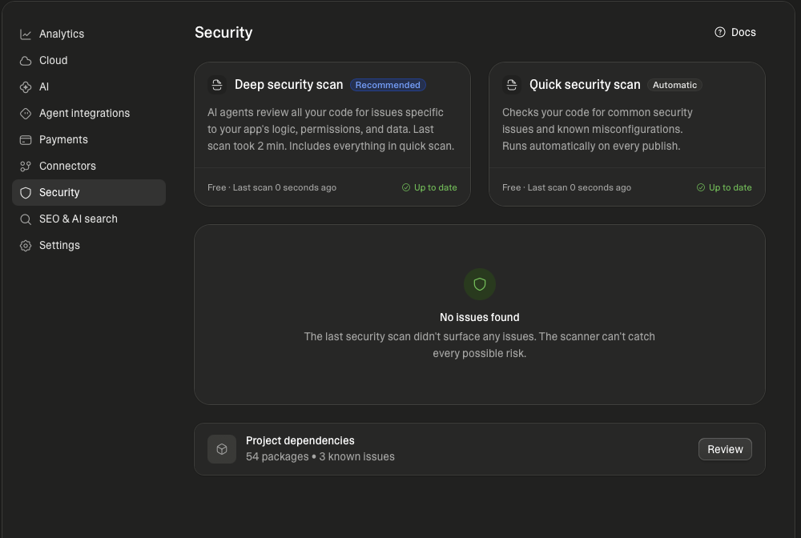

# Auditing an app built from a single prompt

This repository is a security and quality audit of a salon/barbershop booking app ("Chairside") that was generated by [Lovable](https://lovable.dev) from **one plain-language prompt** - the kind a non-technical founder might write. The prompt asked for no security, no access rules and no particular technology. The goal here is to show, on a real example, what to check in an app produced this way and how to fix the issues test-first.

The app itself is a capable TanStack Start + Supabase application: multi-salon, public booking pages, staff calendars, an owner dashboard, customer notes, and two AI helpers.

## The prompt it was built from

> Build me a booking app for hair salons and barbershops. Any salon owner should be able to sign up, create their salon, add their staff and their services with prices and durations. Each salon gets its own public booking page where customers pick a service, a staff member and a free time slot, and book with their name, phone number and email. Staff log in and see their own calendar for the day and week. The owner sees all bookings, can cancel or move them, and has a dashboard with revenue per week and the most popular services. Owners and staff can keep notes on each customer (preferences, past services, anything useful). Add an AI button on the customer page that summarises the customer's history and notes before their appointment, and an AI button that writes a friendly reminder message we can send by WhatsApp or SMS. Make it modern, clean and mobile friendly.

## What the audit found

Lovable's own security scan reported **no issues**, and its report also notes that *"The scanner can't catch every possible risk"*:



This audit found **2 High, 11 Medium, 5 Low and 1 informational** finding. None are the classic "RLS missing, everything open" problems - the foundations are solid (see "What was done well"). The recurring theme is subtler: **business rules are enforced in the browser UI but not in the database/server**, so a client that calls the API directly can do what the UI never offers.

Full report with evidence and reproduction steps: [`audit/AUDIT.md`](audit/AUDIT.md). Access-control matrix: [`audit/role-matrix.md`](audit/role-matrix.md).

| Finding | Severity | Status |
|---|---|---|
| SEC-01 - visitor could change an existing customer's name/email | High | Partially fixed (overwrite blocked; OTP recommended) |
| BH-01 - public bookings had no server-side rules (hours/days/window) | High | Fixed |
| SEC-03 - staff could edit/delete customers and read all bookings | Medium | Fixed |
| BH-02 - no rate limit on public bookings | Medium | Partially fixed (server quotas) |
| SEC-04 - invites auto-linked by email without consent | Medium | Fixed |
| SEC-02 - no length/format validation on public bookings | Medium | Fixed |
| SEC-05 - no security response headers | Medium | Fixed |
| SEC-06 - session token in localStorage | Medium | Recommendation |
| SEC-10 - personal data flows (no retention/erasure/notice) | Medium | Partially fixed (notice added) |
| SE-01 - business rules only in the UI | Medium | Fixed |
| SE-02 - booking slots computed in the visitor's time zone | Medium | Fixed |
| SE-03 - no pagination; ~1000-row cap; client-side revenue | Medium | Recommendation |
| SE-04 - data model (phone normalization, cascade, no audit trail) | Medium | Partially fixed |
| SEC-07 - slug not sanitized in the RPC | Low | Fixed |
| SEC-09 - prompt-injection surface in outgoing AI messages | Low | Fixed |
| SEC-11 - `.env` committed; dev-only dependency advisories | Low | Recommendation |
| SEC-12 - auth behaviour (brute-force not throttled in the test project) | Low | Recommendation |
| SE-05 - thin tests, some `any`, vendor lock-in | Low | Recommendation |
| SEC-08 - RLS helper functions executable by anon | Info | Fixed |

## What was done well

Row-level security is enabled on all six tables and tenants are genuinely isolated; anonymous visitors never touch tables directly (only three security-definer RPCs); double-booking is prevented by a database exclusion constraint; the service-role key stays server-side; AI calls run with the user's own token. These are verified by the passing tests in [`audit/tests/`](audit/tests) and listed in the report.

## Before and after

- **`lovable-original`** branch - the app exactly as generated, untouched.
- **`main`** branch - the audited app: one commit per finding, with schema changes in a new migration (`drizzle/migrations/0001_audit_hardening.sql`); the original `0000_migration.sql` is untouched.
- Diff: **[`lovable-original` -> `main`](https://github.com/atilbarslan/ai-built-app-audit/compare/lovable-original...main)**

## Reproduce

Everything was tested against a **separate test Supabase project** (your own, not any production project), with fictitious data only. Connection values are read from a local `.env.audit` file that is **not** committed; its variable names (not values) are:

```
AUDIT_SUPABASE_URL=            # https://<ref>.supabase.co
AUDIT_SUPABASE_PUBLISHABLE_KEY=
AUDIT_SUPABASE_SECRET_KEY=
AUDIT_DATABASE_URL=            # postgresql://... (direct/pooler connection)
AUDIT_GEMINI_API_KEY=          # only for the prompt-injection test
```

```sh
npm install
psql "$AUDIT_DATABASE_URL" -f drizzle/migrations/0000_migration.sql       # before: the generated schema
psql "$AUDIT_DATABASE_URL" -f drizzle/migrations/0001_audit_hardening.sql  # after: the fixes
psql "$AUDIT_DATABASE_URL" -f audit/tests/00_fixtures.sql                  # fictitious test data
npx vitest run --config audit/vitest.config.ts                            # evidence + defense tests
```

With only `0000` applied, the finding tests go **red** (they prove the finding); with `0001` applied they go **green** (they prove the fix).

## Reusable checklist

[`CHECKLIST.md`](CHECKLIST.md) - "what to check in an app generated from a single prompt", distilled from this audit.
